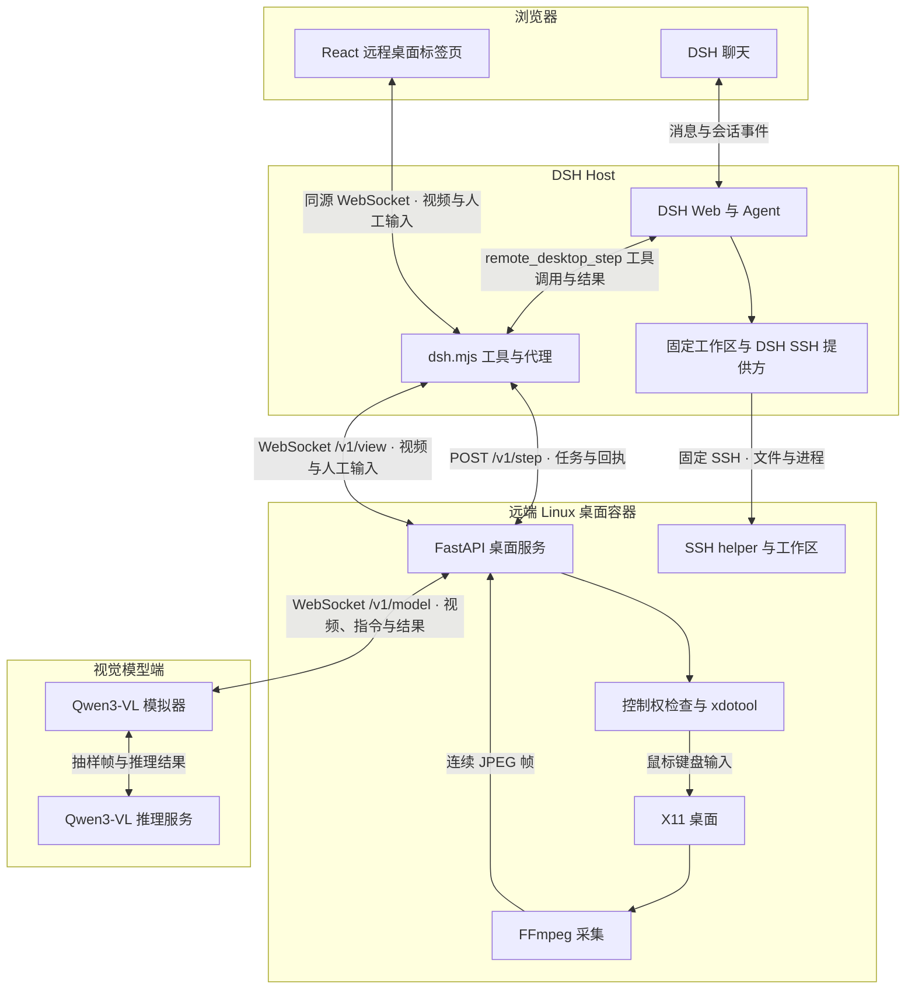

# 当前系统架构

DeepSeek Harness（DSH）管理对话和 Agent 会话。远端桌面服务采集视频、管理输入权和执行动作。视觉模型端持续接收视频，按任务返回观察和候选动作。

## 源码阅读顺序

| 从哪里入手 | 关键实现 |
| --- | --- |
| DSH 如何启动 | [tools/app.sh](../tools/app.sh) 调用 [tools/launch-dsh.mjs](../tools/launch-dsh.mjs)。启动器检查固定 SSHFS 挂载，生成 profile overlay，再启动 DSH Web。 |
| 标签页如何显示 | [dsh-client.js](../frontend/src/dsh-client.js) 注册右侧标签页。[main.tsx](../frontend/src/main.tsx) 管理 WebSocket、Canvas 播放和人工接管，[stream.ts](../frontend/src/stream.ts) 解析帧。 |
| DSH 如何调用桌面 | [dsh.mjs](../avl_computer_use/backend/dsh.mjs) 注册 `remote_desktop_step`，转发到 `/v1/step`，并代理浏览器的 `/avl-desktop/socket`。 |
| 视频如何到模型 | [capture.py](../avl_computer_use/backend/capture.py) 从 X11 或测试源采集 JPEG。[server.py](../avl_computer_use/backend/server.py) 广播给浏览器和模型，[wire.py](../avl_computer_use/backend/wire.py) 定义帧头和动作格式。 |
| 模型在哪里抽样 | [simulator.py](../avl_computer_use/backend/simulator.py) 持续收帧，按采样节奏调用 Qwen3-VL。推理任务独立运行，因此等待 Qwen 响应时仍能收帧。 |
| 谁决定是否执行动作 | [server.py](../avl_computer_use/backend/server.py) 关联任务、模型结果和帧序号。[control.py](../avl_computer_use/backend/control.py) 管理控制权、检查帧新鲜度并用 `xdotool` 执行动作。 |
| 如何固定 SSH 工作区 | [fixed-workspace.mjs](../avl_computer_use/backend/fixed-workspace.mjs) 校验工作区和新建会话请求。SSHFS 只读挂载供 DSH Web 校验路径，DSH 的 SSH 提供方负责实际文件访问和进程执行。 |

## 一次 Agent 桌面操作

1. DSH 调用 `remote_desktop_step`。桌面服务先确认控制权和模型状态，再通过 `/v1/model` 发出 `start`。
2. 模拟器从持续到达的帧中选取任务开始后的抽样帧，调用 Qwen3-VL，并返回带帧序号的 `result`。默认采集 24 fps、抽样 2 fps。
3. 桌面服务复核模型连接、控制权和帧新鲜度，执行至多一个动作，将观察和动作状态返回 DSH。`observe_only=true` 时只返回观察。
4. 人工接管会使等待中的 Agent 任务失效。人工连接断开后，输入权进入暂停状态。动作结果未知时，下一次 Agent 操作须先观察。

自部署的全帧模型使用同一个 `/v1/model` 连接，以 `full` 模式持续编码帧并回报进度。启动命令和环境变量见 [README.md](../README.md)，消息格式见[模型视频流协议](model-stream.md)。
