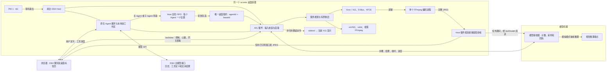
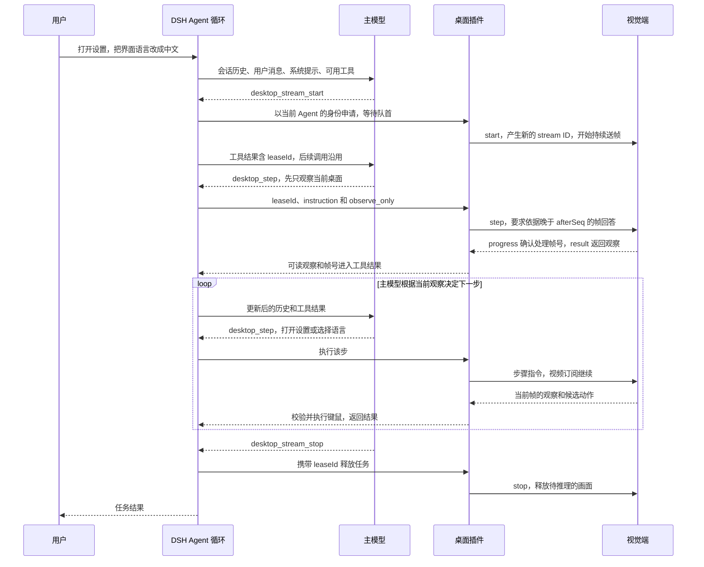
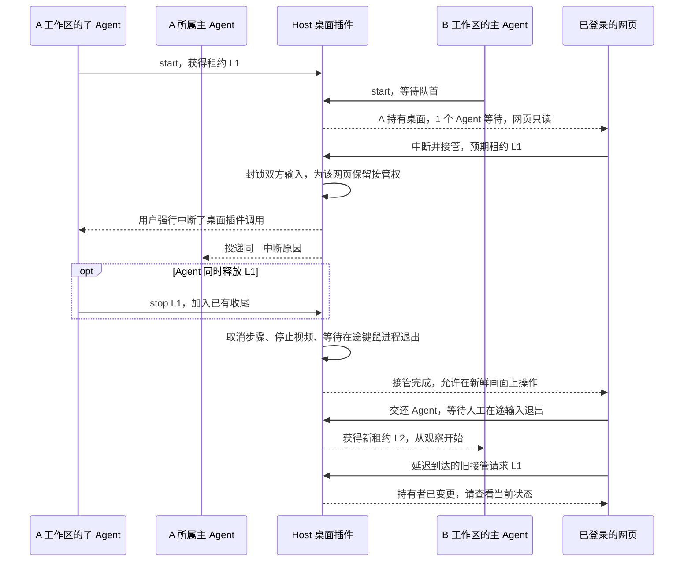
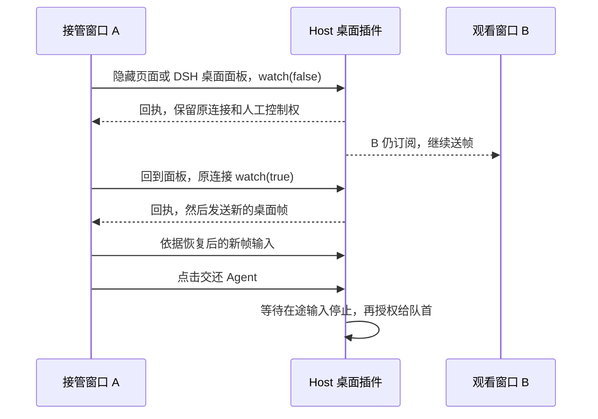

# 从一次桌面任务读懂源码

系统有两个模型角色。DSH 主模型持有聊天上下文、选择工作区里的工具、规划下一步。视觉模型接收订阅期间的连续桌面帧，按当步指令返回观察和可选动作。两者可以使用同一套模型权重，对话和视频协议分别建立连接。

## 部署、控制权与数据方向

模型机器主动建立带 Bearer 令牌的 WebSocket，桌面帧沿这条连接反向发给模型。浏览器使用 DSH owner 会话建立另一条连接。两条链路共用编码结果，各自控制写入。主模型若同时担任视觉模型，它仍通过各自对应的接口取得文本和视频。跨公网可在 DSH 前终止 TLS。图中的视频生产者位于桌面容器，Omni 适配器位于模型侧，部署时无需另设应用层视频转发服务。

桌面容器内的工作区是 DSH 的原生本地目录。文件读写和 shell 沿用 DSH 工作区与会话机制。多个工作区可以同时存在，Host 将 DSH 的 Agent 身份（会话 ID）和每次授权的唯一 leaseId 配对。即使同一个 Agent 再次获准，前次动作和释放请求也只能指向旧租约。sshd 供独立的公钥登录需求使用；插件通过本地进程、协议探针和固定恢复命令进行运维。容器入口只执行一次初始化，随后通过 exec 切换到低权限的 DSH Host。详细进程权限见[容器运行手册](container.md)。

## 文本、提示词与工具循环

上例中的步骤数由主模型按每次反馈决定。一个用户轮次可以包含多轮工具调用。插件一次只允许一个未完成的桌面步骤，每次最多产生一个键鼠动作。DSH 将工具结果呈现为 JSON 文本，包括 `stream`、`seq`、`observation`、`action`。键鼠命令执行完成只证明输入已发出；需要确认界面已切换时，下一步再观察。

| 要修改的行为 | 源码入口 |
| --- | --- |
| 主模型看到的工具名、说明、参数，工具结果如何渲染 | [host/plugin.mjs](../host/plugin.mjs) 的 `tool:avl-desktop` 系统提示段、`register` 和五个 `desktop_*` 工具 |
| DSH 如何拼装系统提示、历史、工具 schema 和模型请求 | 安装版本 `@deepseek-ai/dsh-agent-loop/src/agent.ts` 的 `tools.resolve`、`systemPrompt.assemble`、`systemPrompt.project` 和 `boundaryMessages`。需要改变全局提示时可使用 DSH 的系统提示扩展接口 |
| 视觉模型看到的系统提示、图像、单步文本 | [model/adapter.py](../model/adapter.py) 的 `DECISION_PROMPT` 和 `Omni.decide`。一次请求包含一张 JPEG、单步指令和观察模式；历史由 DSH 持有 |
| 步骤与帧绑定、控制权及输入后的重新观察 | [host/desktop.mjs](../host/desktop.mjs) 的 `start`、`step`、`viewerCommand` |
| 允许的鼠标、按键和输入参数 | [host/x11.mjs](../host/x11.mjs) 的 `inputArguments`。点位按 0–1000 归一化，再转换成实际屏幕像素 |
| 接收器和自部署模型的消息协议 | [模型握手、回执与步骤示例](model.md) |
| DSH 页签注册、屏幕绘制、人工接管页面 | [客户端入口](../frontend/client.js)、[连接管理](../frontend/src/connection.js)、[React 面板](../frontend/src/main.jsx) |

## 多 Agent 排队和人工交接

- **排队单位是 Agent。** 同一 Agent 的重复申请共享原位置，各次调用可独立取消。所有申请都取消、轮次结束或 Agent 被释放时，Host 将其移出队列。父 Agent 和它的子 Agent 独立排队。父 Agent 要把桌面工作委派给子 Agent 时，应先释放自己的租约，再等待子任务完成。
- **持锁范围是整项桌面任务。** 工具返回、模型思考、等待新帧、视频空闲停送都保留租约。空闲后用原 `leaseId` 发起只观察步骤，Host 重新开流。显式释放、当前轮次结束和任务中断会撤销租约。轮到队首时才送模型视频，等待者不能发动作或释放别人的任务。
- **网页在“正在中断”时仍可观看。** 两个网页同时中断同一任务，最先受理的连接获得接管保留权。Host 同步校验网页显示的 `leaseId`，同一个接管者重复请求沿用同一次收尾。旧的 `stop` 仅报告指定租约已释放。若下一位 Agent 已获授权，旧网页的接管请求会收到持有者变更提示。
- **中断通知和输入确认有各自的完成条件。** 即使模型在两步之间思考，Host 也会投递中断原因。网页等待的是本地在途操作停止；已发出的输入可能已经生效。开始收尾后 2.5 秒仍不能确认停止时，控制台显示告警并禁止双方输入。其后确认退出，也须由操作者显式接管或交还。接管者在交接中或接管后掉线，同样进入暂停。
- **维护操作也受仲裁。** 读取健康状态可并发。Agent 主动请求恢复桌面服务时，正在持锁的 Agent 要提供当前租约。空闲时可单独执行恢复。恢复进行期间会阻止新的输入和交接授权。自动健康探测可并行。需要自动重启进程时，监控也须取得维护权限；已有步骤、输入或交接占用时延后重试，本次不消耗恢复次数。

中断通知通过 DSH 收件箱投递，消息绑定被中断的租约、持有者和授权时确认的主 Agent。已加载的 Agent 可在下个模型步骤读到，已卸载的会话可在恢复后读到。Host 将待投递记录放在 DSH 状态目录下的 SQLite 文件，两位接收者的消息均持久化后删除该记录。投递失败会重试，用稳定的消息 ID 去重。实现见[中断通知](../host/notifications.mjs)。

队列仅在当前 Host 进程内有效。Host 重启后旧的待执行输入和排队请求失效。代码入口见[桌面状态机](../host/desktop.mjs)和[可取消的队列](../host/agent-queue.mjs)。

## 多个网页、暂停观看和人工交还

**两个网页会启动几个采帧进程？** 每个 Host 按需启动一个 FFmpeg。每张 JPEG 只编码一次，Host 将同一份数据分别交给各个可见窗口及已订阅的模型。每个接收端有独立的 WebSocket 和待发送帧；多开窗口会增加出口带宽，各个窗口看到画面的时间可能略有差异。最后一个视频订阅取消时 FFmpeg 停止；后台保留的控制连接本身没有采帧需求。

**A 接管后，B 能操作吗？人工停手多久会交还？** A 和 B 能观看同一个桌面，只有 A 的连接有键鼠权限。A 停下来阅读、切换浏览器标签、折叠 DSH 右栏或切换到其他 DSH 页签，都保留控制权。要正常结束，A 点击「交还 Agent」。Host 等待在途输入停止后再授权给队首。人工接管没有无操作超时。`AVL_STREAM_IDLE_MS` 只管理模型视频。

**接收模型或网页掉线后会发生什么？**

| 情况 | Host 的处理与恢复 |
| --- | --- |
| 视觉模型的 WebSocket 断开 | 结束当前模型租约，取消未完成的步骤并中止在途输入。输入可能已经生效。网页可继续观看，已有的排队请求保留。视觉端重连后按队列重新授权，新持有者先观察；旧租约和旧结果失效。 |
| 只读窗口 B 关闭 | 移除 B 的视频和控制连接。A 的人工控制权和其他订阅继续有效。 |
| 接管窗口 A **隐藏**，控制连接正常 | A 停收视频，保留接管权及心跳。若 B 在观看则继续向 B 送帧。A 回到桌面后须收到并显示新帧才能输入。 |
| A 在接管期间或接管交接中**真正断线** | 即使 B 在线，输入也会暂停。A 重连或 B 明确点击「接管」或「恢复 Agent 控制」后才能继续。关闭桌面页签、刷新页面或浏览器回收后台页，也可能导致真实断线；重连不会重放输入。 |

这里的模型断线指视觉接收器与 Host 之间的 WebSocket。接收器与 Omni 推理 API 之间的单次 HTTP 失败由适配器报告为推理失败。这两种故障的影响范围不同。[视觉适配器](../model/adapter.py)

### 为什么保留单窗口输入

DSH 的已认证浏览器共用 owner 身份；在原生终端上，每次只有一个连接负责输入和调整终端尺寸，其他连接可以观看。桌面插件沿用了“共同观看、单方输入”，并以「中断并接管」按钮明确操作意图。另一个可行方案是 A 和 B 共享人工输入权限，但 A 打字时 B 点击另一个窗口会改变键盘焦点，即使 Host 顺序执行输入也可能输错位置。如果以后需要跨设备交接，可以添加显式的窗口间移交。目前使用「交还 Agent」或断线后的暂停恢复流程。可在本项目安装的 `@deepseek-ai/dsh-client-connection/README.md` 和 `@deepseek-ai/dsh-api-terminal-controller/README.md` 核对 DSH 的原生行为。

### 一个控制连接，独立开关视频

面板通过 `/avl/view?watch=0` 建立连接，然后按可见性发送 `{"type":"watch","id":"…","enabled":true}` 或 `false`。暂停只撤销这个连接的视频订阅并清掉尚未发出的帧。前端丢弃旧帧和未完成的解码，恢复订阅回执后才接收新的画面。浏览器心跳保留。关闭页签、连接关闭或心跳失联会进入掉线流程。DSH 通过页签的 `keepMounted` 保留已访问的 iframe，使隐藏和关闭对应不同的生命周期。[DSH 页签](../frontend/client.js) · [页面连接](../frontend/src/connection.js) · [Host 观看与控制仲裁](../host/desktop.mjs)

## 采集、延迟与流量

`/avl/model` 握手成功后默认只传控制和心跳。模型订阅或桌面标签页观看触发采集，两者都结束时停止 FFmpeg。浏览器观看期间也能开关模型订阅。显示标签页绘制独立 JPEG；容器自带 noVNC 作为回环上的只读维护入口。

每一张完整 JPEG 都带本次订阅标识、帧序号、几何尺寸和 Host 单调时钟的编码完成时间。每条连接最多有一次正在写出的消息，下一张待发送的旧帧可被更新的帧覆盖。写阻塞超过 `AVL_STREAM_WRITE_TIMEOUT_MS` 就终止该连接。在 TCP 已经接收的数据无法撤回，重连和新订阅会丢弃旧代次的结果。传输和计时分别见[发送队列](../host/transport.mjs)、[统计实现](../host/metrics.mjs)。

| 控制台指标 | 测量边界及读法 |
| --- | --- |
| 采集 FPS / 模型接收 FPS | 前者在 Host 收齐编码帧时计数，后者用模型收到的数据和模型时钟计算。用后者判断目标机器是否收到了 12–24 fps |
| 处理 FPS / 模型采样丢弃 / 接收序号缺口 | 分别反映视觉处理完成、模拟器主动跳过的推理机会、模型未收到的帧。模拟器可以持续收 24 fps 并按 2 fps 上限调度推理 |
| 接收 P50/P95 / 帧到视觉状态 P95 | 从 JPEG 编码完成开始，至模型收齐 JPEG 或生成视觉状态。四时间戳往返估算时钟偏移，同时显示误差上界。上界大于 50 ms 或校时过期时隐藏单向值 |
| Host 确认 P95 | 在同一 Host 时钟上计到收到进度回执，包含模型批量回报和返程耗时。在公网校时不确定时仍可读 |
| 控件定位命中率 | 用模型实际预测的点击位置与带标注的目标比对，使用[独立评测器](../model/evaluate.py)。生产帧没有真值，结果在离线评测中生成 |

FPS 使用约 5 秒的滚动窗口，延迟使用最近 30 秒的样本。默认 24 fps 是采集目标；真实桌面分辨率、画面变化、带宽和模型服务均会影响实测值。基准分别覆盖 640×360 的合成画面和 1920×1080 的独立 X11 动态桌面。统计起点在 JPEG 已编码之后，要测从物理界面变化到浏览器呈现的总延迟需另外测量显示和编码。测量条件、实测数据和复现命令见[传输基准](model.md)。

## 断开、超时和接管

| 事件 | 插件如何处置 | 如何继续 |
| --- | --- | --- |
| 模型 WS 断开、写超时或心跳失联 | 取消步骤、释放订阅，晚到的旧结果失效。浏览器可继续观看 | 模型重新握手；主模型重新开流并观察 |
| 浏览器或桌面面板隐藏 | 暂停该窗口的视频订阅，保留连接和原控制权 | 恢复可见后等待新帧 |
| 用户中断并接管 | 阻止新输入，通知持有者和所属主 Agent，待在途操作停止后授权给该网页 | 人工交还后按原队列顺序授权 |
| 接管者控制连接断开或显示服务重建 | 暂停控制，作废旧控制权及旧动作 | 从已登录页面重新接管或交还 |
| 候选动作依据帧过旧、未经处理确认或来自旧订阅 | 拒绝输入；若输入已经开始时发生中断，结果标记为未知 | 根据新画面判断实际状态，不自动重放 |
| full 模式接收或处理低于 12 fps | 暂停自动输入，仍可观察；模拟器单独显示真实接收和推理速率 | 恢复吞吐后根据新帧再决策 |
| 订阅空闲超时 | 停止向模型送帧，控制权仍归当前 Agent | 持原租约发起只观察步骤，恢复推流 |
| 步骤超时、会话轮次结束或会话被释放 | 终止模型送帧，保留独立的浏览器观看需求 | 下一轮显式开启新订阅 |
| 本地服务连续异常 | 按依赖关系和重试次数恢复。失败组件出现在 DSH 全局提示、桌面面板和 Host 日志中 | 查阅组件、次数和日志，修复后自动复查 |
| DSH 主进程退出 | tini 等待结束后退出；容器由部署平台管理 | 使用部署平台的重启策略，持久卷可保留工作区和历史 |

桌面模式的控制权约束作用于插件的输入接口。普通 DSH shell 与桌面共享 Unix 用户和本地 X11 权限，具有桌面用户能力的其他程序仍可直接向 X11 输入。同机多个工作区应属于同一信任域。固定运维入口独立处理 sudo，仅允许必要的 sshd 恢复。图形程序和 shell 使用普通桌面用户权限。

启动入口、后台探测和端到端回归分别见[启动脚本](../tools/dsh.sh)、[服务恢复](../host/supervision.mjs)、[独立显示测试](../tests/test_isolated_x11.py)、[多工作区重启测试](../tests/test_workspaces.py)、[视频链路测试](../tests/benchmark.mjs)。
