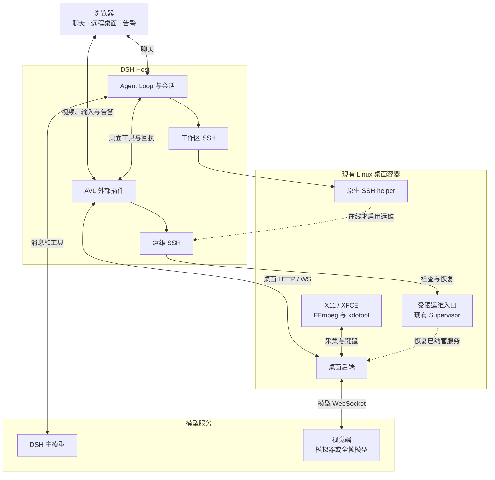
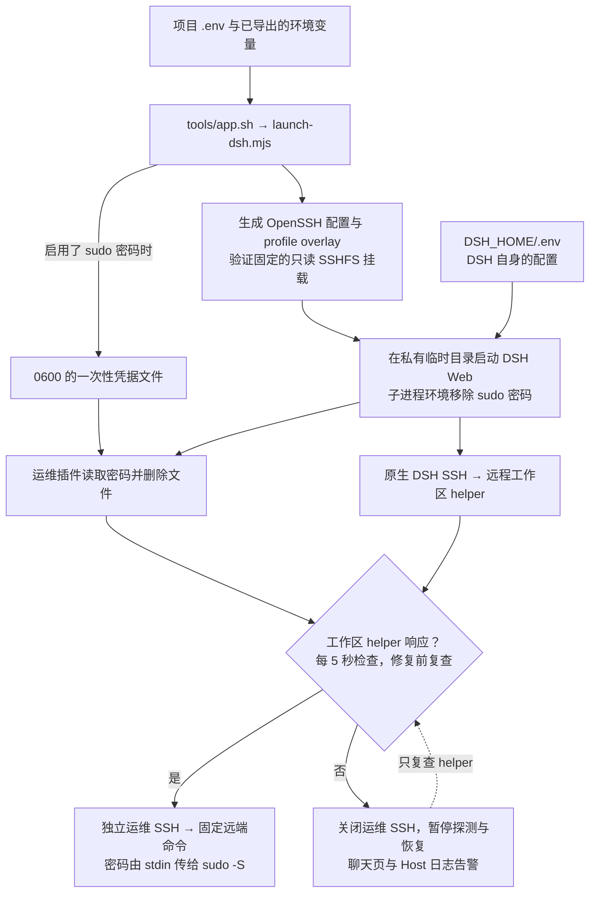
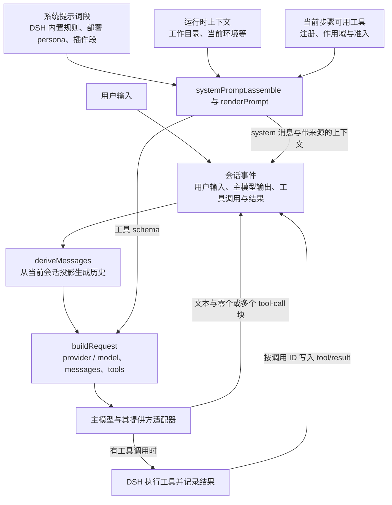
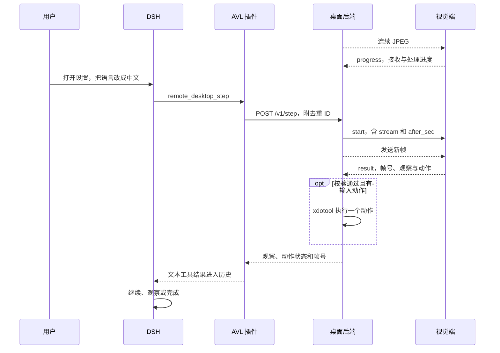

# AVL Computer Use 架构与源码导读

本项目以 DeepSeek Harness（DSH）为主。DSH 的主模型理解任务、调用工具并根据回执决定下一步。桌面视觉模型依据实时画面给出观察和候选动作，Python 桌面后端校验后执行。以下 DSH 源码链接对应本项目锁定的 `0.2.2-rc.5`，执行 `npm ci` 后可在本地打开。部署命令见 [README.md](../README.md)。

## 1. 系统总图



浏览器使用 DSH 登录态访问同源页面、`/avl-desktop/socket` 视频代理和运维状态。DSH Host 持有桌面服务令牌，用它访问 `/v1/step`、`/v1/view` 等接口。视觉客户端用独立的模型令牌接入 `/v1/model`，桌面后端同一时间接受一个视觉客户端。现有 noVNC 可以独立查看桌面，直接使用其输入功能时由现有 VNC 服务控制；上图的接管逻辑覆盖通过 AVL 桌面标签页发送的输入。 [DSH 插件](../avl_computer_use/backend/dsh.mjs) · [桌面端接口](../avl_computer_use/backend/server.py)

## 2. 启动配置、工作区和运维 SSH



DSH 本身会读取启动目录的 `.env`，优先级是进程已有变量、启动目录 `.env`、`DSH_HOME/.env`。在本项目的启动方式中，启动器已经读取了项目配置。如果 DSH 仍从仓库目录启动，`AVL_SUDO_PASSWORD` 会有机会从项目文件重新进入 DSH 环境，项目 `.env` 中的 `DSH_HOME` 也会触发当前 DSH 版本的启动检查。现在用没有项目 `.env` 的临时目录启动，`DSH_HOME` 由启动器作为环境变量传入。sudo 密码通过独立文件交给运维插件，插件删除文件后仅在运维连接中使用该密码。`DSH_HOME/.env` 用于 DSH 自身的配置。 [DSH 环境加载器](../node_modules/@deepseek-ai/dsh-app-boot/src/index.ts#L256) · [本项目启动器](../tools/launch-dsh.mjs) · [凭据接收](../avl_computer_use/backend/dsh.mjs#L165)

| 连接 | 用途与恢复方式 |
| --- | --- |
| **只读 SSHFS** | 为 DSH Web 提供本机可检查的工作区路径。启动器检查挂载来源、路径和只读属性。`AVL_WORKSPACE` 指向固定目录，新建会话时也会约束远端规范路径。 |
| **DSH 原生 SSH** | 由远端 helper 提供文件操作、子进程和沙箱。已失效的 DSH SSH 连接不会自动重连或重放工作区操作。SSH 与挂载恢复后手动重启 DSH Web；会话历史使用专用 `DSH_HOME`。 |
| **运维 SSH** | 工作区 helper 在线期间按需建立并复用 SSH 连接。发现 helper 失联时关闭运维连接。SSH 登录使用公钥。已设置 sudo 密码时，通过固定命令执行探测和恢复。默认运维别名复用工作区账号；已有独立运维账号可通过 `AVL_OPS_SSH_HOST` 选择自己的 OpenSSH 别名。 |

[SSH 配置生成](../tools/ssh-config.mjs) · [固定工作区](../avl_computer_use/backend/fixed-workspace.mjs) · [DSH SSH 断线行为](../node_modules/@deepseek-ai/dsh-ssh/README.zh.md#L60) · [运维连接](../avl_computer_use/backend/desktop-supervision.mjs)

在默认配置下，工作区与运维可以复用服务器地址、端口、账号和密钥。DSH 与运维插件各自拥有 OpenSSH 主连接，以便运维继续支持受限登录账号。插件通过 DSH SSH 子进程提供者的只读 RPC 检查 helper，单次 RPC 超时为 2 秒。即使桌面修复尚在进行，Host 也会按 5 秒周期检查 helper。检测到断线后立即取消本机侧运维命令并关闭运维主连接。远端已受理的修复可能完成，helper 恢复后从新的探测结果开始判断。SSHFS 挂载有自己的连接，挂载故障单独告警。

## 3. DSH 主模型怎样得到提示词



DSH 为每个拟执行的 `step` 读取当前 `provider/model`，先解析该步可用工具，再调用 `systemPrompt.assemble()`。系统段按 `order` 排序、渲染模板并用空行拼接，随后作为 `system` 消息进入历史。工作目录等动态上下文有自己的来源，可形成带来源的 `user` 角色消息。工作区 `AGENTS.md` 等文件由工作区指令插件加载。工具名称、说明和参数 schema 作为 `tools` 传给模型适配器。`buildRequest()` 从 `deriveMessages()` 取得当前生效的历史快照，因此下一次请求能读到之前的模型输出、工具结果和新一轮用户输入。 [Agent 循环](../node_modules/@deepseek-ai/dsh-agent-loop/src/agent.ts#L289) · [提示词组装](../node_modules/@deepseek-ai/dsh-system-prompt/README.zh.md#L100) · [模型请求](../node_modules/@deepseek-ai/dsh-agent-loop/src/agent.ts#L732) · [会话历史](../node_modules/@deepseek-ai/dsh-session/src/index.ts#L1073)

一个用户任务可以在同一轮 `turn` 内经历多个 `step`。主模型可在一次输出中给出多个工具调用。DSH 内部将它们表示为一组 `tool-call` 内容块，每块包含 `id`、`name` 和原始 JSON 字符串 `arguments`。工具执行器使用调用 ID 关联回执并写入 `tool/result`。桌面后端一次只接纳一个在途 `/v1/step`，每次最多执行一个动作。像“打开设置，再改语言”这样的依赖步骤，应在前一步回执后再发下一次桌面调用。 [工具调用结构](../node_modules/@deepseek-ai/dsh-llm/src/types.ts#L111) · [批量工具执行](../node_modules/@deepseek-ai/dsh-tools/src/batch.ts#L246) · [桌面任务限制](../avl_computer_use/backend/server.py#L189)

追查实际请求时，先看会话事件中的 `system/message`、`request/header` 和 `tool/result`。它们能定位系统提示词、模型与工具配置的更新，以及每个调用的回执。需要核对某一步完整的消息顺序时，从 `buildRequest()` 查看 `deriveMessages()` 返回的历史快照，具体 HTTP 格式由对应模型适配器转换。 [请求构造和事件记录](../node_modules/@deepseek-ai/dsh-agent-loop/src/agent.ts#L661)

### 想调整模型行为时改哪里

| 想调整 | 对应入口 |
| --- | --- |
| 针对当前远程项目的协作／操作规则 | 在固定远程工作区维护 `AGENTS.md`。用户级指引可以放在 `$DSH_HOME/AGENTS.md`。该类文件作为 DSH 主模型的上下文，详细的加载与更新规则见 [工作区指令插件](../node_modules/@deepseek-ai/dsh-agent-instructions/README.zh.md)。 |
| 部署级系统提示词 | 在专用 `$DSH_HOME/cordis.patch.yml` 覆盖 `system-prompt` 的 `personaPrefix` 或 `personaSuffix`。需要按代码动态贡献一段时，可在本项目 Cordis 插件用 `ctx.systemPrompt.section({name, order, text})` 注册。 [提示词配置与 API](../node_modules/@deepseek-ai/dsh-system-prompt/README.zh.md#L31) |
| 主模型怎样理解和调用桌面工具 | 在 [dsh.mjs](../avl_computer_use/backend/dsh.mjs#L197) 修改 `defineTool()` 的 `description`、`parameters` 或结果呈现。主模型靠工具说明决定何时调用以及怎样写 `instruction`。 |
| 主模型本身 | 在 DSH Web 的“模型”设置中配置提供方，并在聊天输入框选择模型。将主模型也设为 Qwen3-VL 时，要验证对应服务能返回结构化工具调用。 [DSH 模型设置](../node_modules/@deepseek-ai/dsh-client-ui-settings-models/README.zh.md) |
| 视觉侧怎样观察、判断坐标并返回动作 | 修改 [simulator.py](../avl_computer_use/backend/simulator.py#L47) 的 `PROMPT`，或修改自部署全帧客户端的模型输入。动作类型／参数发生变化时，同步检查 [wire.py](../avl_computer_use/backend/wire.py#L48) 和 [control.py](../avl_computer_use/backend/control.py#L146)。 |

部署级规则示例，可写入专用 `$DSH_HOME/cordis.patch.yml`。

```yaml
- id: system-prompt
  config:
    personaPrefix: >-
      操作桌面时，每次给 remote_desktop_step 一个紧接当前状态的小目标。
      根据工具回执和新的画面确认该操作，再决定下一步。
```

## 4. 一条桌面指令怎样走完整个闭环

以“打开设置，把界面语言改成中文”为例。拆解由主模型结合工具能力和当前画面逐步完成。第一次可以把“打开设置”交给视觉端；得到回执后，主模型再决定如何进入语言菜单或是否需要先观察。实际调用次数取决于界面状态。



`remote_desktop_step` 只向桌面服务发送 `instruction`、`observe_only` 和用于去重的 `request_id`。DSH 的完整对话历史和工具列表留在主模型链路上。模拟器的 `QwenVision.infer()` 对每次调用构造两条消息。

```text
system  simulator.py 的 PROMPT
user    本次 instruction 文本 + 对应的一张 JPEG
```

该请求通过 OpenAI 兼容的 `/chat/completions` 发给 `AVL_QWEN_MODEL`。只观察任务会给指令加上只观察约束，桌面后端也会强制禁止输入。视觉端返回 `observation` 和 `action`，`action` 可以是 `click`、`key`、`type`、`scroll` 或 `null`。工具回执里的 `observation` 来自**执行动作前所用的帧**。`applied` 表示键鼠操作已执行，界面结果需要下一张画面确认。 [视觉请求组装](../avl_computer_use/backend/simulator.py#L59) · [动作校验与回执](../avl_computer_use/backend/server.py#L189)

浏览器画面、模型收帧和模型推理分别计数。后端默认采集 24 fps，支持配置为 12–24 fps。模拟器持续接收视频，默认只抽样 2 fps 进行 HTTP 推理，推理期间仍继续收帧。真实全帧模型应作为 `/v1/model` 的 WebSocket 客户端接入，并上报实际处理到的 `processed_seq`。全帧模式下，主模型发来的桌面步骤需要视觉端的接收与处理速率都达到约 12 fps。切换 DSH 主模型时，视觉端的配置单独管理。 [采集实现](../avl_computer_use/backend/capture.py) · [模型视频流协议](model-stream.md)

采集循环把帧交给各连接的发送任务，无需等待网络。每条连接只保留一张尚未写入网络的画面，新帧会覆盖旧帧。DSH 视频代理向浏览器转发时采用同样的策略。任务开始、取消、控制状态和输入回执走有界的顺序队列。单次 WebSocket 写入等待上限由发送端的 `AVL_STREAM_WRITE_TIMEOUT_MS` 控制，默认 1000 毫秒。桌面后端控制发往模型与 DSH 的两路，DSH Host 控制发往浏览器的一跳。写入超时或控制队列溢出时仅关闭该连接，重连后继续接收新画面。 [后端分发](../avl_computer_use/backend/control.py) · [DSH 视频代理](../avl_computer_use/backend/dsh.mjs)

## 5. 控制权、超时与恢复

| 发生什么 | 系统怎样处理 |
| --- | --- |
| 人工点击“接管桌面” | 后端切换到人工模式，使在途 Agent 任务失效。接管窗口断开后进入暂停，重连后由用户明确接管或交还 Agent。 |
| 视觉模型断开、画面停更或 FFmpeg 重启 | 在途任务失效。采集重启会产生新 `stream`，旧帧不能执行输入。`/v1/health` 只检查桌面新帧，模型未就绪时另在桌面面板提示。 |
| 画面仍在更新，模型使用了过旧的帧 | 候选动作需匹配当前任务、控制代次和采集流，且对应帧年龄不能超过 `AVL_FRESH_SECONDS`，默认 5 秒。最新桌面帧和视觉进度另有约 1.5 秒的就绪检查。等待本次视觉决策的超时由 `AVL_DECISION_TIMEOUT` 控制，默认 20 秒。 |
| 动作已发出，但连接断开或回执无效 | DSH 阻止下一次自动输入，先执行 `observe_only=true` 确认新画面，再决定下一步。配置 `AVL_DESKTOP_STATE` 后，后端用 SQLite 保存近期请求去重和人工暂停状态。 |
| 运维 SSH 可达，某个桌面组件持续不健康 | 连续两次失败后开始有界恢复，每个组件最多尝试 3 次。X11/VNC 故障优先处理。受限运维入口通过已配置的 Supervisor 恢复已纳管服务。 |
| 运维 SSH 自身不可达，或原生工作区 SSH 已失效 | helper 可达且仅运维 SSH 失联时，下一轮重新尝试运维连接。helper 失联时暂停运维，只复查 helper 并显示聊天页全局告警。`sshd` 本身停止时，靠宿主机已有恢复通道。原生 DSH 工作区连接失效后，检查 SSHFS 并手动重启 DSH。 |

后端用 `stream` 区分采集代次、用 `seq` 指定视觉依据、用 `epoch` 标识当前控制权。浏览器的人工操作同样携带帧序号和控制代次，由服务端校验。`/v1/step` 用 `409` 表示明确拒绝，用 `502` 表示可能已输入但结果未知。浏览器可以重新连接视频，旧的待确认键鼠事件不会重发。 [输入仲裁](../avl_computer_use/backend/control.py) · [后端状态与接口](../avl_computer_use/backend/server.py) · [持久化](../avl_computer_use/backend/recovery.py) · [浏览器重连](../frontend/src/main.tsx#L66)

排查时可先看三个入口。`GET /avl-desktop/health` 是 DSH Host 的运维快照，桌面关闭时仍可读取；桌面端 `GET /v1/health` 用 `204 / 503` 表示是否存在可用的新帧；带桌面令牌调用 `GET /v1/status` 可以看到采集帧率、模型就绪和控制权。运维功能依赖现有桌面部署准备好的 SSH、固定运维入口和 Supervisor 配置，配置方式见 [README 运维章节](../README.md#运维-ssh-和-sudo)。 [告警读取](../frontend/src/dsh-client.js) · [运维探测与恢复](../avl_computer_use/backend/desktop_ops.py)
